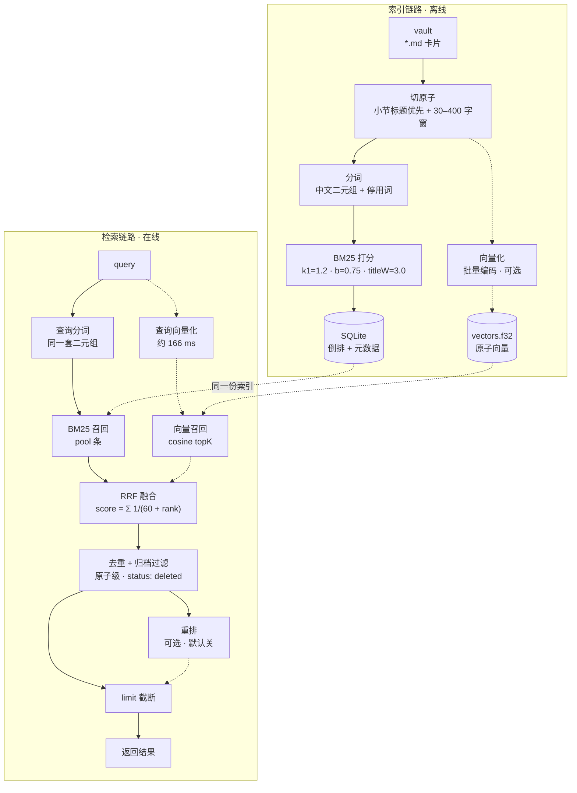

# memory-kb2

MCP 记忆库：把本地 Markdown 卡片变成可检索的长期记忆。BM25 倒排 + 语义向量 + RRF 融合，不绑定客户端。

**面向 Agent 的知识库，不是陪伴型长记忆。** 它记的是「这个项目为什么这么决定」「这个结论后来被推翻了」，不是聊天记录。所以它关心结论是否仍然成立（归档语义），也关心不同语料要用不同参数（三档 Profile）。

[](./LICENSE)
[](./package.json)
[](https://modelcontextprotocol.io/)
[](./docs/MECHANISM.md)

---

## Why

会话结束，上下文就没了。你上周讨论过的方案、踩过的坑、做过的决定，下次开新会话时它一个字都不记得。

把记忆塞进 system prompt 能撑一阵，但几百张卡之后就撑不住了——不是超长，就是淹没了真正相关的那几条。检索是唯一的出路。

而检索的坑比想象中深。这个项目在 20 轮控制变量实验里，有五次得出「某个组件没用」的结论，其中**四次最后追溯到观测手段的问题**：查询取自卡正文、送进重排的是 40 字碎片、候选池只有 20、零成本模拟替代真实实现。这些过程全部留在 [DEBUG-LOG.md](./docs/DEBUG-LOG.md) 里，包括被推翻的结论。

起点更具体一点：[ORIGIN.md](./docs/ORIGIN.md) 记录了它为什么被做出来——以及一个库说「标题权重越大越差」、另一个库说「×3 最好」时，怎么判断谁对。

---

## Features

- **混合检索**：BM25（`node:sqlite` 内建）+ 向量召回 → RRF 融合 → 内容去重
- **零外部检索依赖**：BM25 走 Node 内建 SQLite；向量与重排可选，无凭据自动退回 BM25-only
- **场景档位自动识别**：启动时按语料特征判一次（wiki / chat / engineering），不用手工切环境变量
- **自适应候选池**：`clamp(1.09·√cards, 20, 80)`，池深随库规模走
- **归档卡片语义**：`status: deleted` 的结论默认不返回，查历史决策时显式打开
- **可证伪的自检**：`selfcheck.mjs` 检查索引自洽、归档规模、候选池不变量、延迟构成、服务层准确率
- **不绑定客户端**：任何支持 MCP 的客户端都能连

---

## Architecture

[](./docs/assets/architecture.png)

检索与索引是两条链路，共用一份索引：

- **两个入口**：MCP Client（给 AI 用，经 stdio 服务）与 CLI（给人用，直接读写索引）
- **检索**：入口 → Index（BM25 + 向量两路召回）→ RRF 融合 → 去重 → 返回
- **索引**：vault（Markdown）→ indexer（切原子 + 分词）→ Index
- **可选路径**：Embedding API 提供查询向量，Rerank API 做精排——两条都可关闭
- **Profile 路由**：启动时按语料特征判一次，换库不用改配置


### 数据流：从卡片到结果



实线是默认路径，虚线是可选路径（向量与重排都有凭据才启用）。

每一步的参数与实测依据：

| 步骤 | 参数 | 依据 |
|---|---|---|
| 切原子 | 30–400 字窗口，小节标题优先 | 更碎则噪声大，更长则语义分散 |
| 分词 | 中文二元组 + 停用词 | 零词典依赖；59 条标注 top1 93.2% |
| BM25 | k1=1.2 / b=0.75 | 实测 0.2–0.75 区间排序不变，用默认值 |
| 标题权重 | titleW=3.0 | 与 1.3 在 59 条上打平，概念名查询略优 |
| 候选池 | clamp(1.09·√cards, 20, 80) | 571 卡→26，5413 卡→80（两个拟合点） |
| RRF | k=60 | 常数，排名融合不依赖分数尺度 |
| 去重 | 正文前 160 字指纹 | 真实库存在完整副本，去重后 top5 唯一内容 3.60→5.00 |
| 归档过滤 | 原子级 active 标志 | 卡级过滤会漏掉「部分结论已归档」 |
| 重排 | 输入必须是完整 chunk | 喂 40 字原子碎片会让结论反转 17pp（第 16 轮） |

### 三档 Profile

| 档位 | 判定条件 | limit | 向量 | rerank | 实测 |
|---|---|---:|---|---|---|
| **engineering**（默认） | 其余 | 5 | 开 | 关 | 571 卡 59 题：top1 93.2% / top3 100%，p50 189 ms |
| **wiki**（法学） | 平均标题 < 15 字 | 8 | 关 | 关 | 941 卡：BM25 MRR 0.529 > dense 0.434；概念名 recall@1 98.9% |
| **chat**（已冻结） | 原子/卡 ≤ 3 且正文均长 < 800 字 | 14 | 开 | 开 | 5413 卡 · pool 80：命中 65% / 覆盖 0.588 |

三档的差异不是拍脑袋定的：法学卡是概念名驱动的，标题即答案，密集向量的语义泛化反而引入近义干扰（dense 0.434 < BM25 0.529），所以 wiki 档关向量；聊天库要想起多轮细节，名额与召回宽度更关键，所以 limit 14 + 向量 + 重排全开。

`chat` 档冻结，是因为 evidence 命中 48.3% 的天花板在**名额分配**而非检索链路——再调算法没有意义。冻结的含义与依据见 [docs/DEBUG-LOG.md](./docs/DEBUG-LOG.md) 第 20 轮。

细节见 [docs/MECHANISM.md](./docs/MECHANISM.md)。

---

## Quick start

### 命令行：给人用

```bash
git clone https://github.com/NachoGPT7007/memory-kb2 && cd memory-kb2
npm install

npx memory-kb2 index                     # 建索引（读 $MEM_VAULT，默认 ~/.memory-vault）
npx memory-kb2 stats                     # 库有多大、倒排多少项、归档几张
npx memory-kb2 search "候选池为什么"      # 命令行检索，看命中与分数
npx memory-kb2 selfcheck                 # 本体体检
```

也可以 `npm run index` / `npm run stats` / `npm run search -- "..."` / `npm run selfcheck`。

CLI 和 MCP 服务走同一条检索链路（两路召回 + RRF + 去重），区别只是 CLI 没有查询向量时会自动退回 BM25。

### MCP 客户端：给 AI 用

```json
{
  "mcpServers": {
    "memory_kb2": {
      "command": "node",
      "args": ["/absolute/path/to/memory-kb2/bin/memory-kb2.mjs", "serve"],
      "env": { "MEM_VAULT": "/absolute/path/to/your/vault" }
    }
  }
}
```

一个 MCP 进程绑一个库。要在同一会话里切多个库，就按库起多个实例。

---

## Measured

工程库 571 卡、59 条人工标注查询：

| 配置 | top1 | top3 |
|---|---:|---:|
| 纯 BM25 | **93.2%** | **100%** |
| + 向量 RRF | 92% | 100% |

延迟 p50 189 ms / p95 225 ms，其中 166 ms（88%）是一次远端 embedding 往返。

完整数据集、指标定义与全部实验数字见 [docs/BENCHMARK.md](./docs/BENCHMARK.md)。

**本项目没有向公开榜提交过成绩。** PrecisionMemBench（纯检索断言基准）实测 10/76 = 13.2%——与官方基线（Qwen3 14.3%、Hindsight 14.3%、Mem0 11.7%）持平——详见 [BENCHMARK 第 11 节](./docs/BENCHMARK.md)。 与 chat-memory-benchmark 1.0 / 2.2 的关系、以及为什么自测数字不能直接和榜上 A 分比较，写在 [BENCHMARK 第 10 节](./docs/BENCHMARK.md)——那一节也列出了聊天域偏弱、只在两个合成人物上测过这些坏消息。

---

## Docs

| 文档 | 内容 |
|---|---|
| [HANDOFF](./docs/HANDOFF.md) | 交接与实验计划：三刀的变量、对照组、判定标准、回滚点 |
| [GAP](./docs/GAP.md) | 与企业级 RAG 的逐环节对比：14 个环节里缺了哪些，为什么端到端打不过 |
| [ORIGIN](./docs/ORIGIN.md) | 为什么做、怎么变成现在这样。含 title 权重 1.0/1.3/3.0 的两次校准与架构之争 |
| [MECHANISM](./docs/MECHANISM.md) | 卡片与原子、索引构建、检索链路、RRF、候选池、档位判定、一致性保障 |
| [TUNING](./docs/TUNING.md) | 每个参数的取值依据，含**被证伪的参数**与已知未解五项 |
| [BENCHMARK](./docs/BENCHMARK.md) | 数据集与指标、全部实测数字、延迟分解、可证伪的候选池不变量 |
| [DEBUG-LOG](./docs/DEBUG-LOG.md) | 20 轮调试全过程，保留全部被推翻的结论 |

---

## Project layout

```
memory-kb2/
├── src/
│   ├── server.mjs        MCP 服务：memory_search / memory_update / memory_stats
│   ├── index.mjs         索引器：切原子、分词、BM25 倒排、可选向量
│   └── embed-api.mjs     Embedding / Rerank 的 HTTP 适配层
├── scripts/
│   └── selfcheck.mjs     本体体检：索引自洽、候选池不变量、延迟构成、准确率
├── docs/                 机制、调参、基准、调试史
└── examples/             最小的 vault 示例
```

---

## 状态与路线

### 已经到顶的

| 能力 | 指标 | 判断依据 |
|---|---|---|
| 工程库精确检索 | top1 93.2% / top3 100%（59 条） | 剩余失败题为标注串模糊 |
| 法学 wiki 概念名 | recall@1 98.9%（940 卡） | 标题即答案，加权已饱和 |
| 延迟 | p50 189 ms | 其中 166 ms 是 embedding 往返，属结构性，调参无解 |

### 有证据的待办

| 事项 | 已有信号 | 缺什么 |
|---|---|---|
| 重叠聚类按簇分配名额 | 模拟中覆盖 +35~43% | 未落地到生产 |
| 时间维度（到点/今天到期类） | 自然榜 X4 类召回为 0 | 未验证；且卡片 mtime、frontmatter、正文时间三者常不一致，先要定用哪个 |
| 法学库原子数不一致 | 首次 15718、后续 8468，无法复现 | 缺可复现的最小样本 |
| 正文未进索引 | 已知：wiki 卡片正文不参与检索 | 属设计待定，改了会影响 wiki 档 |

### 边界：做了一半或数据不足的

| 事项 | 现状 | 缺什么 |
|---|---|---|
| **冷热分层**（hot / warm / cold / dead） | 已在 `selfcheck` 里实现：按召回账本算四层比例与标记漂移。**但它只做统计，没有参与检索**——hot 卡不会因为「热」而排前 | 分层要进检索，先得有可信的账本。当前账本只有 13 次检索，cold/dead 判定不可信（检查项自己会报这条） |
| **反向关联 / 二次检索** | 会话记录里未找到完整实验数据，无法给出结论 | 需要重新定义「什么算关联」并跑一次基线 |

### 已否决，不再列入路线

| 方向 | 否决依据 |
|---|---|
| **多跳检索** | 桥接精度 1–3%（跳出去 610 条只有 18 条是答案依据）；工程库 top3 已 100%，只有下降风险。详见 [DEBUG-LOG](./docs/DEBUG-LOG.md) 第 20 轮 |
| 查询级路由 | 59 条上 90% vs 统一 92%，持续证伪 |
| BM25F 字段加权 | 模拟 +17.5pp，实现 −21.7pp |
| 多角度 BM25（句法切分） | 命中 50.0% → 50.0%，切出的片段与原句共享同一批 bigram |
| rerank 默认开 | 修正评测输入后与无重排打平（90% vs 92%），多付 0.8 秒 |
| 外置向量库 | **无实测依据**。此前写在这里是推测：万卡级规模从未出现过，`vectors.f32` 全量加载的实际内存占用没有测过 |

完整的功能账本（保留 9 项 / 撤掉 13 项及原因）见 [ORIGIN 第 3 节](./docs/ORIGIN.md)。

## Contributing

Issue 用于讨论，PR 欢迎但按现状维护、不承诺跟进节奏。提交前请跑 `npm run selfcheck`。

---

## 设计来源

- **[memory-eternal](https://github.com/EternalNight996/dsh-memory-eternal)**（EternalNight996，MIT）
  本项目的前身。vault 的卡片结构、以及「对话结束自动沉淀成卡」的思路来自它。
  kb2 在它之上重写了检索链路：BM25 倒排 + 向量召回 + RRF 融合 + 三档 Profile。
- **[chat-memory-benchmark](https://github.com/Ornn8/chat-memory-benchmark)**（Ornn8）
  聊天域题库 M01 / M02 的来源。它是面向**陪伴型** AI 的中文记忆基准，
  而 kb2 是 Agent 知识库——借它的题库只用于测「长对话里的细节召回」这一项能力，
  不在于定位相同。哪一档因此冻结，见 [DEBUG-LOG 第 20 轮](./docs/DEBUG-LOG.md)。
- **[Archify](https://github.com/tt-a1i/archify)**（tt-a1i，`@tt-a1i/archify-dsh`）
  本 README 架构图的绘制工具。
- **RRF** —— Cormack、Clarke、Büttcher，SIGIR 2009。

依赖见 `package.json`，不在此列。

---

## License

MIT。详见 [LICENSE](./LICENSE)。

[](https://github.com/deepseek-ai/deepseek-harness)
