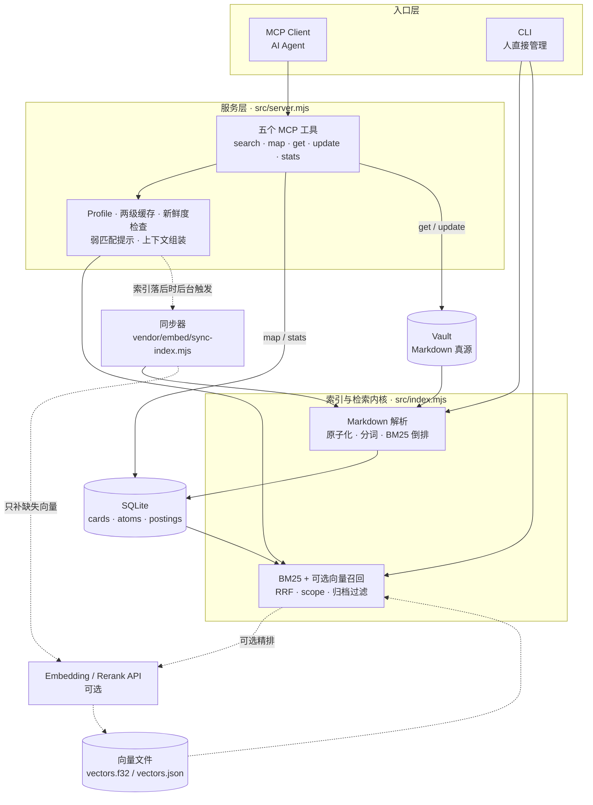
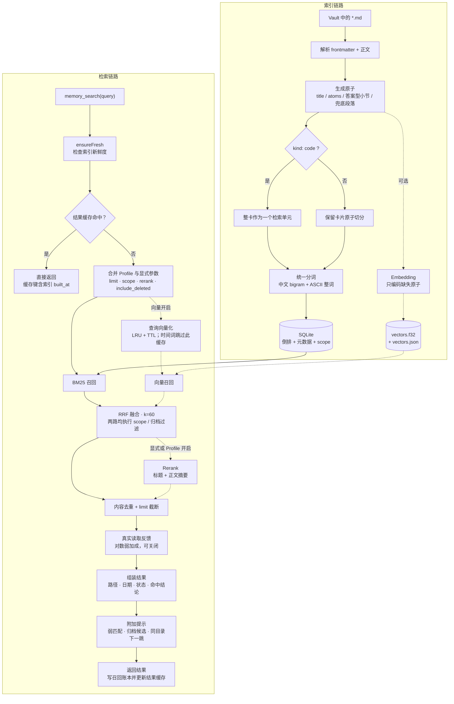

# memory-kb2

把本地 Markdown 卡片变成可探索、可检索、可维护的 Agent 知识库。核心检索采用 BM25 倒排、可选语义向量与 RRF 融合，通过 MCP 或 CLI 使用，不绑定某个 AI 客户端。

**面向 Agent 的知识库，不是陪伴型聊天记忆。** 它保存的是「这个项目为什么这样决定」「哪个结论已经失效」「那次故障怎样修复」，而不是把整段聊天记录重新塞回上下文。

[](./LICENSE)
[](./package.json)
[](https://modelcontextprotocol.io/)
[](./docs/MECHANISM.md)

---

## Why

会话结束后，模型不会自然带走项目背景。把全部历史写进 system prompt 又会在卡片增多后失效：上下文变长，真正相关的结论反而被淹没。

kb2 将记忆分成两层：

- **Markdown 卡片是真源**：人和 Agent 都能阅读、修改、版本管理。
- **索引只是可重建的派生物**：SQLite 倒排与可选向量服务于检索，可以随时从卡片重建。

它也不只提供一个「黑盒搜索框」。`memory_map` 让 Agent 先知道库里有什么，`memory_search` 定位候选，`memory_get` 读取完整卡片，`memory_update` 修正过时结论，`memory_stats` 检查运行状态。这五件事构成一个最小但完整的知识库工作流。

项目的设计与参数来自多轮控制变量实验，包括被推翻的结论。为什么某些看似合理的优化最终没有采用，见 [ORIGIN](./docs/ORIGIN.md)、[DEBUG-LOG](./docs/DEBUG-LOG.md) 和 [EXPERIMENT-2026-11-20](./docs/EXPERIMENT-2026-11-20.md)。

---

## Features

### 检索与排序

- **混合检索**：自建 SQLite BM25 倒排 + 可选向量召回，使用 RRF 按名次融合，避免直接比较两种不同尺度的分数。
- **原子级索引**：标题、frontmatter atoms、答案型正文小节分别入库；没有匹配小节的卡片按段落兜底，`kind: code` 卡片则整卡入库。
- **三档 Profile**：启动时根据语料统计量选择 `engineering` / `wiki` / `chat` 参数；能力仍在同一套引擎中，Profile 只负责调参。
- **自适应候选池**：默认 `clamp(round(1.09 × √cards), 20, 80)`，也可用环境变量覆盖。
- **归档与作用域**：默认排除 `status: deleted`；调用方可显式传入 `scope`，BM25 与向量两路都会过滤。
- **可选精排**：支持远端 rerank，默认是否开启由 Profile 与显式参数决定，不把重排成本强加给所有查询。

### Agent 工作流

- **五个 MCP 工具**：搜索、全库地图、整卡读取、卡片更新、状态检查。
- **可分步探索**：搜索结果带路径、更新日期、异常状态、命中结论和同目录下一跳提示；Agent 可以自行继续 `map → search → get`，不需要服务端内部再调用一个 LLM。
- **弱匹配提示**：向量可用时，以查询与全库原子的最大余弦相似度识别低相关内容；只提示，不伪造「绝对无结果」，也不改变排序。
- **读取反馈**：`memory_get` 的真实读取记录会给后续检索一个默认很弱的对数加成；`MEM_FEEDBACK_BOOST=0` 可关闭。
- **索引新鲜度检查**：检索前检查卡片 mtime 与同步标记，发现落后时后台触发同步，不阻塞当前查询。

### 运行与维护

- **零必需外部检索服务**：BM25 使用 Node.js 内置 `node:sqlite`；没有模型凭据时可走 BM25-only。
- **两级缓存**：查询向量 LRU/TTL 缓存 + 带索引版本的结果缓存；重建索引后旧结果自然失效。
- **同步策略分工**：SQLite 全量重建，向量只补缺失原子；模型变化时重新编码，避免不同模型向量错位拼接。
- **可检查而非凭感觉**：`selfcheck` 检查索引完整性、归档规模、候选池不变量、延迟构成，并可在副本上跑服务层评测。
- **部署边界简单**：一个 MCP 进程绑定一个 vault；多库通过多个实例隔离。

---

## Architecture

下图按当前源码重绘。实线表示基础链路，虚线表示可选模型能力或按需触发的同步链路。



关键边界：**卡片不是 SQLite 的缓存，SQLite 才是卡片的派生索引。** `memory_update` 修改的是 Markdown；后续同步再更新索引。`memory_map` 与 `memory_get` 是只读工具，只有 `memory_update` 会修改卡片。

### 数据流：从卡片到结果



几个容易误解的实现细节：

1. **去重和 `limit` 截断发生在融合之后**，避免重复副本提前耗尽名额。
2. **读取反馈是弱加成，不是另一条检索路**，只应影响分数接近的卡片。
3. **弱匹配提示依赖向量**；没有向量时保持原有行为，不使用中文 token 覆盖率硬猜相关性。
4. **查询向量缓存与结果缓存不是同一层**：前者省去远端 embedding，后者省去整条本地检索与组装链路。
5. **CLI `index` 只构建 SQLite**；向量文件由同步器生成。仅运行 `index` 不会自动得到向量索引。

机制与参数依据分别见 [MECHANISM](./docs/MECHANISM.md) 和 [TUNING](./docs/TUNING.md)。个别早期文档中的链路描述若与当前源码不同，以源码和最新实验记录为准。

---

## MCP tools

| 工具 | 主要参数 | 用途 |
|---|---|---|
| `memory_search` | `query`、`limit`、`rerank`、`deep`、`include_deleted`、`scope` | 检索候选卡，返回分数、路径、日期、状态、命中结论和后续探索提示 |
| `memory_map` | `dir`、`budget`、`include_deleted` | 按目录列出卡片标题、路径和日期；超出字符预算时明确截断 |
| `memory_get` | `path` | 读取整张卡；限制路径必须位于 vault 内，并记录一次真实读取反馈 |
| `memory_update` | `path`、`text`、`close_atom` | 追加带日期的修正记录，或将指定 atom 标记为失效 |
| `memory_stats` | 无 | 查看卡数、原子数、模型/API 状态、缓存命中率、降级原因和索引新鲜度 |

`scope` 是**检索过滤条件，不是权限系统**。它不会自动从 cwd 或问题文本推断，也不提供用户认证、租户隔离或加密。

---

## Quick start

### 1. 安装

要求 **Node.js ≥ 22**，因为索引层使用内置 `node:sqlite`。

```bash
npm install -g memory-kb2    # 当前 latest 为 0.4.3，CLI bin 已实测可运行
```

从仓库运行：

```bash
git clone https://github.com/NachoGPT7007/memory-kb2.git
cd memory-kb2
npm install
```

### 2. 准备 vault

`MEM_VAULT` 指向存放 Markdown 卡片的目录。没有卡片时，检索引擎只能返回空库结果，不会替你生成知识。

```bash
mkdir -p ~/notes
export MEM_VAULT="$HOME/notes"
memory-kb2 index
memory-kb2 stats
memory-kb2 search "某个结论"
```

一张最小卡片可以这样写：

```markdown
---
title: 检索融合为什么用 RRF
status: active
scope: [domain:engineering]
---

## 结论

BM25 分数没有固定上界，向量相似度与它的分数尺度不同。RRF 使用各路排名进行融合，因此不要求两路原始分数可直接比较。
```

正文行需满足当前切分长度约束才会成为正文原子；生产卡片也可以使用 frontmatter `atoms`。完整示例见 [`examples/minimal-vault`](./examples/minimal-vault)。

### 3. 接入 MCP 客户端

```json
{
  "mcpServers": {
    "memory_kb2": {
      "command": "memory-kb2",
      "args": ["serve"],
      "env": {
        "MEM_VAULT": "/absolute/path/to/your/vault"
      }
    }
  }
}
```

**建议始终显式设置 `MEM_VAULT`。** 当前 CLI 与 MCP 的默认查找顺序并不完全相同：

| 入口 | 未设置 `MEM_VAULT` 时 |
|---|---|
| CLI | 使用 `~/.memory-vault` |
| MCP 服务 | 优先使用已存在的 `$DSH_HOME/memory-vault`，否则使用 `~/.memory-vault` |

一个进程只绑定一个库。需要多个库时，启动多个 MCP 实例，分别设置不同的 `MEM_VAULT`。

### 4. 可选：启用向量与重排

设置 `ALI_API_KEY` 或 `DASHSCOPE_API_KEY`。模型与维度可通过 `EMBED_API_MODEL`、`RERANK_API_MODEL`、`EMBED_API_DIM` 覆盖。

在仓库中手动同步 SQLite 与向量：

```bash
MEM_VAULT=/absolute/path/to/your/vault node vendor/embed/sync-index.mjs
```

同步器会重建 SQLite，只编码缺失向量。MCP 服务检测到 vault 变更时也会在后台调用它；请确保同步器与服务使用同一个 `MEM_VAULT`。

没有凭据时可以显式关闭模型路径：

```bash
MEM_VECTOR=0 MEM_RERANK=0 memory-kb2 serve
```

### 5. 自检

```bash
memory-kb2 selfcheck
```

`--serve` 会启动真实 MCP 往返并可能触发索引同步，**只对 vault 副本使用**；私有标注题集不随公开仓库提供，因此陌生环境不能复现全部历史准确率数字。

---

## Profiles

| Profile | 自动判定条件 | 默认 limit | 向量 | rerank | 适用语料 |
|---|---|---:|---|---|---|
| `wiki` | 平均标题长度 < 15 字 | 8 | 关 | 关 | 概念名驱动、标题本身高度承载答案的卡片 |
| `chat` | 非 title 原子/卡 ≤ 3，且 body 原子均长 < 800 字 | 14 | 开 | 开 | 多轮对话沉淀；该档检索调参已冻结，不代表问题已解决 |
| `engineering` | 其余 | 5 | 开 | 关 | 项目决策、排障记录、技术知识卡 |

显式环境变量优先于自动档位。常用项：

| 环境变量 | 作用 |
|---|---|
| `MEM_VECTOR` | `0` 关向量，`1` 强制开；未设置时由 Profile 决定 |
| `MEM_RERANK` | `0` 关重排，`1` 开；单次调用的 `rerank` 参数也可覆盖 |
| `MEM_DEFAULT_LIMIT` | 覆盖默认返回条数，服务层仍限制在 1–20 |
| `MEM_TITLE_W` | 覆盖标题权重；服务层默认统一使用 3.0 |
| `MEM_POOL` / `MEM_POOL_MIN` / `MEM_POOL_MAX` | 固定候选池，或调整自适应上下限 |
| `MEM_BODY_SECTIONS` | 注入答案型小节标题词表，适配法学等非工程语料 |
| `MEM_BODY_MAX` | 调整正文原子长度上限，默认 400 |
| `MEM_STRIP_WIKILINKS` | 默认剥离 `[[wikilink]]` 括号、保留锚文本；设 `0` 关闭 |
| `MEM_ALIAS` | 设 `1` 开启确定性别名扩展；默认关，只作用 BM25 路 |
| `MEM_QVEC_CACHE` / `MEM_RESULT_CACHE` | 分别关闭查询向量缓存 / 结果缓存：设为 `0` |
| `MEM_WEAK_COS` | 调整弱匹配余弦阈值，默认 0.60 |
| `MEM_FEEDBACK_BOOST` / `MEM_FEEDBACK_ALPHA` | 关闭读取反馈，或调整弱加成系数 |

换库时最需要重新检查的不是 BM25 的 `k1` / `b`，而是**正文小节词表、标题权重、候选池与返回名额**。具体证据见 [TUNING](./docs/TUNING.md)。

---

## Measured

以下数字是特定语料、特定配置下的历史实测，不是对任意 vault 的保证。不同基准的指标与任务口径不能直接横向换算。

| 场景 | 样本与配置 | 结果 |
|---|---|---|
| 工程知识库 | 571 卡，59 条有效人工标注 | BM25 top1 **93.2%**；混合检索 top3 **100%** |
| 法学概念卡 | 约 941 卡 | 概念名 recall@1 约 **98.8–98.9%** |
| 法学正文细节 | 注入领域小节词表、正文入索引 | top1 **87.7% → 97.6%**；概念名指标基本持平 |
| CodeRAG-Bench RepoEval | 6 仓库、373 查询，函数转卡及对应实验配置 | nDCG@10 **93.2**，打平论文 BM25 基线，不是超过 |
| PrecisionMemBench | 76 条断言，BM25 路 | 基线 **13.2%**；显式 scope **23.7%**；scope + alias **26.3%** |
| 查询向量缓存 | 64 条工程查询，同进程配对 | 命中 p50 **54 ms**，净省约 **191 ms** |
| 检索结果缓存 | 同上，重复查询 | 第二次 p50 **55 ms → 1 ms**，返回序列 64/64 一致 |

负面结果同样保留：chat-memory-benchmark 2.2 的本地 M01 / M02 成绩低于所用基线；工程库上的高 top1 不能外推成陪伴型长记忆能力。本项目没有向公开榜提交成绩，私有评测卡片与标注集也不随仓库发布。

完整口径、失败案例和实验边界见 [BENCHMARK](./docs/BENCHMARK.md) 与 [EXPERIMENT-2026-11-20](./docs/EXPERIMENT-2026-11-20.md)。

---

## 适合与不适合

**适合：** 一题一段的精准召回，例如查一个配置、一条项目决策、一次排障记录、一个概念定义；再由 Agent 按需读取整卡并综合判断。

| 场景 | 当前边界 |
|---|---|
| 长文档 / PDF 问答 | 输入单位是 Markdown 卡片，不是通用文档解析器；需要先整理成卡 |
| 陪伴型聊天记忆 | 可以检索对话沉淀卡，但多段证据拼接与长期细节覆盖仍是弱项 |
| 代码检索 | `kind: code` 已修复函数被切碎的问题，并在 RepoEval 打平 BM25 基线；但它仍不是源码索引器，也不能替代 grep / 代码专用 RAG |
| 多用户服务 | 没有认证、权限模型和租户隔离；scope 只是过滤，不是安全边界 |
| 高并发写入 | SQLite 索引采用整体重建，向量做增量补齐；不是多写者数据库 |
| 自动沉淀对话 | 本仓库提供检索与显式 `memory_update`，不负责从对话自动抽取卡片；DSH 侧沉淀属于独立集成层 |
| 服务端自主多跳推理 | 当前提供分步探索原语，但问题分解、多轮验证由调用方 Agent 完成 |
| 图文与多模态 | 只索引文本 |

---

## 与 DSH 的关系

kb2 的检索引擎和 MCP 服务不依赖 DSH，任何支持 MCP stdio 的客户端都可以使用。

DSH 生态中的 `dsh-armory/packages/dsh-memory-kb2` 是独立集成层，负责宿主装配与会话沉淀等能力；它不改变本仓库的检索内核。**本仓库本身不会监听会话，也不会自动把聊天内容写进 vault。**

集成层的演进与本次核对结果：

| 时间 / 提交 | 状态 |
|---|---|
| 2026-11-02 `1afa954` | 从 memory-eternal fork 出 kb2 集成层，改为写 v2 卡并指向新检索链路 |
| 2026-11-02 `44a80b7` | 增加 `memory_update` 工具，允许追加修正或关闭失效原子 |
| 2026-11-08 `59c53be` | 整包临时下线 |
| 2026-11-20 `ec4825c` | 恢复插件；把失效的 `agent/turn-stopping` 监听改为 `session/event` 的 `turn/end`，并放宽 peer 依赖 |
| 2026-11-20 `05c4604` | 改为任务级沉淀：连续空闲 `captureIdleMs`（默认 5 分钟）后处理整段任务；一次产出 0–3 张卡 |

截至本次重写，集成层已有一张 `submittedBy: deepseek-harness` 的沉淀卡在生产 vault 落盘，说明写入链路已端到端通过。该卡的内容与沉淀质量仍属于个人数据，不在本 README 中展开。

---

## Status and roadmap

### 已落地

- 混合检索、三档 Profile、自适应候选池、归档过滤与内容去重
- `map / search / get / update / stats` 五个 MCP 工具
- 显式 scope、可选别名扩展、法学正文词表注入
- 查询向量缓存、索引版本感知的结果缓存
- 弱匹配提示、同目录下一跳、真实读取反馈弱加成
- SQLite 全量重建 + 向量增量同步
- `kind: code` 整卡入库与统一 CLI

### 仍需证据或实现

| 方向 | 当前缺口 |
|---|---|
| scope 自动推断 | 当前只支持调用方显式传入；自动推断的准确率未验证 |
| 多段证据覆盖 | 聊天与复杂问答需要的不只是单卡 top1，名额分配仍未解决 |
| Agentic 多步检索 | 已有 map/get/下一跳原语，服务端不负责问题分解与证据验证 |
| 冷热分层参与排序 | 真实读取反馈已落地，但完整冷热分层策略与可信样本仍不足 |
| 跨语料参数泛化 | 候选池公式与 Profile 阈值来自有限真实库，第四类语料需要重新标定 |

多跳扩散、查询级路由、默认开启 rerank、BM25F 等方向曾因实测无效或收益不足被否决；不要因为它们「看起来合理」就重复加入。详见 [ORIGIN](./docs/ORIGIN.md)。

---

## Project layout

```text
memory-kb2/
├── bin/
│   └── memory-kb2.mjs          统一 CLI：index / search / stats / selfcheck / serve
├── src/
│   ├── server.mjs              MCP 工具、Profile、缓存、同步触发、结果组装
│   ├── index.mjs               卡片解析、原子化、BM25、向量召回、RRF
│   ├── embed-api.mjs           Embedding / Rerank HTTP 适配与错误状态
│   └── alias-table.json        可选确定性别名表
├── scripts/
│   ├── memory-index.mjs        索引内核兼容入口
│   └── selfcheck.mjs           索引、候选池、延迟与服务层检查
├── vendor/embed/
│   └── sync-index.mjs          SQLite 重建与缺失向量同步
├── bench/                      评测方法；私有数据不发布
├── examples/minimal-vault/     最小卡片示例
└── docs/                       机制、调参、基准、实验史与交接记录
```

## Docs

| 文档 | 内容 |
|---|---|
| [MECHANISM](./docs/MECHANISM.md) | 卡片、原子、索引、召回、RRF、Profile 与一致性 |
| [TUNING](./docs/TUNING.md) | 参数默认值、实测依据与已证伪方向 |
| [BENCHMARK](./docs/BENCHMARK.md) | 指标口径、基准结果与不可横比的原因 |
| [EXPERIMENT-2026-11-20](./docs/EXPERIMENT-2026-11-20.md) | 缓存、scope、别名、法学正文等单变量实验 |
| [ORIGIN](./docs/ORIGIN.md) | 设计决策账本：为什么保留、修正或撤掉某项能力 |
| [DEBUG-LOG](./docs/DEBUG-LOG.md) | 调试全过程，包括错误结论及其根因 |
| [GAP](./docs/GAP.md) | 与更完整 RAG / Agent 记忆系统的差距 |
| [HANDOFF](./docs/HANDOFF.md) | 实验纪律、阶段状态与后续验证事项 |

## Contributing

Issue 用于讨论，PR 欢迎。修改检索行为前请先写清变量、对照组、样本量、判定标准与回滚点；一次只改一个变量。提交前至少运行：

```bash
npm run selfcheck
```

不要把私有卡片、真实查询标题、凭据或本机绝对路径提交到公开仓库。

---

## 设计来源

- **[memory-eternal](https://github.com/EternalNight996/dsh-memory-eternal)**：前身。vault 卡片结构与对话沉淀思路来自它；kb2 重写了检索与探索链路。
- **[chat-memory-benchmark](https://github.com/Ornn8/chat-memory-benchmark)**：聊天域题库来源。借用它测试长对话细节召回，不代表项目定位相同。
- **[Archify](https://github.com/tt-a1i/archify)**：旧版 PNG 架构图的绘制工具；当前 README 图表改为可维护的 Mermaid。
- **RRF**：Cormack、Clarke、Büttcher，SIGIR 2009。

依赖见 [`package.json`](./package.json)。

## License

MIT，详见 [LICENSE](./LICENSE)。

[](https://github.com/deepseek-ai/deepseek-harness)
